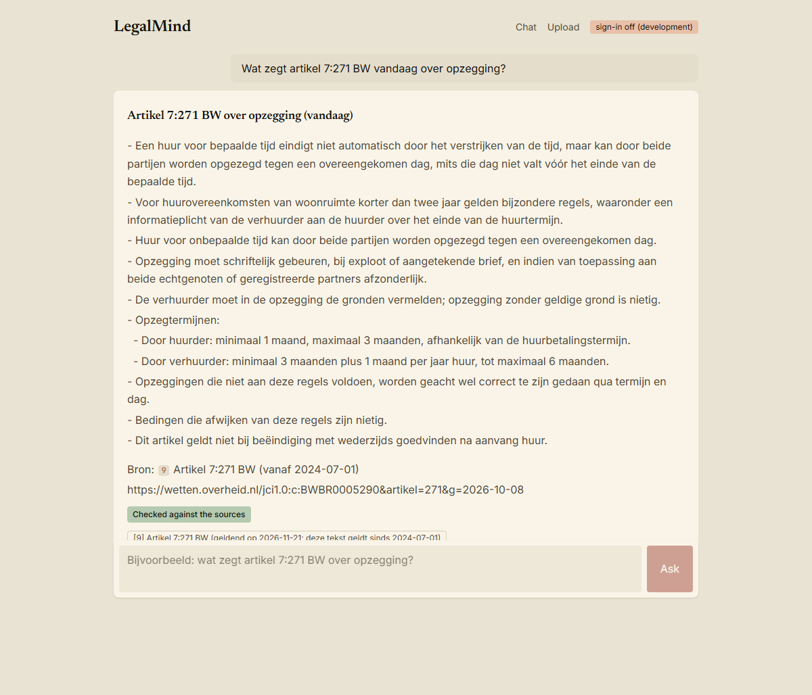
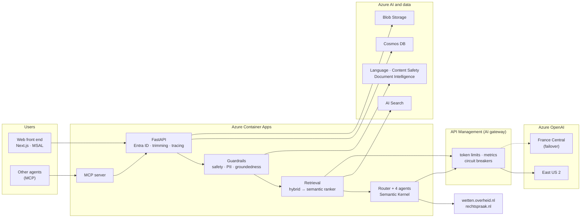

# LegalMind AI

[](https://github.com/munyaradzi-zhou/LegalMind-AI/actions/workflows/ci.yml)


[](LICENSE)

**A multi-agent legal assistant for Dutch legal services, built, deployed and measured on Azure.**
Lawyers sign in and ask questions about their matters' documents, Dutch legislation and
published case law. Every answer cites its sources, and says whether those sources were
checked to back it. A user only ever sees passages from the matters they work on.



---

## What it does

| | |
|---|---|
| **Answers with sources, checked** | Hybrid retrieval (BM25 + vectors, semantic ranker) over chunks that each carry a header naming their document. Four Semantic Kernel agents (document analysis, legal research, drafting, compliance) behind a router. An LLM groundedness check reads every answer against its sources and labels it `documents`, `not_grounded`, `unverified` (the check failed: it fails closed) or `no_documents`. |
| **Live Dutch law** | The research agent looks up the current text of an article on wetten.overheid.nl and published rulings on rechtspraak.nl. Results are numbered, cited by their BWB id or ECLI with a link, and checked like any other source. |
| **Who sees what** | Entra ID sign-in with app roles (Lawyer, Paralegal, Admin) and one security group per matter. The search engine filters every query by the user's groups and fails closed; privileged documents only reach lawyers. |
| **Web front end** | Next.js + TypeScript. MSAL sign-in, the pipeline's real progress streamed over SSE, numbered citations that open the passage or the official text, Admin-only upload. |
| **AI gateway** | API Management between the app and Azure OpenAI: per-user token limits, token metrics per user, and failover to a second region when the first is throttled or failing. |
| **Responsible AI and data protection** | Content Safety and PII detection on every question and answer; conversations stored with personal data replaced by its category; retention per data type; optional private networking. |
| **Operations** | Five alerts (errors, latency, unverified answers, model throttling, restarts), an operations workbook, a runbook tested by incident drills, and an evaluation gate on pull requests. |
| **MCP server** | The knowledge base and the live legal sources as Model Context Protocol tools for other agents. |

## Architecture



All service-to-service calls use Microsoft Entra ID through one user-assigned managed
identity; key authentication is switched off on every service. Everything is in Bicep
([`infra/`](infra)); network isolation (private endpoints, public access off) is a parameter.

Why it's built this way, with the measurement behind each choice:
[architecture decision records](docs/adr/README.md).

## Measured

On the dev deployment, November 2026. The evaluation suites are in
[`tests/evaluation`](tests/evaluation); the gate runs them on pull requests.

| Answer quality (66 golden questions, through the live API) | |
|---|---|
| Expected facts in answers | 96% |
| Right source cited | 98% |
| Unanswerable questions declined or flagged, including near-misses | 14 / 14 |
| Right passage in the top 3 (68 queries; hybrid + semantic ranker vs keyword) | 88% vs 56% |
| Questions about live law and case law: source cited, facts present, grounded | 8 / 8 |

| Security and operations | |
|---|---|
| Searches by 5 test users across matters and roles; passages leaked | 340; **0** |
| Isolated deployment: services reachable from the internet with a valid token | **0 / 9** |
| Incident drills: alerts that fired | 5 / 5 |
| Load test: errors from 2 to 30 concurrent users | **0** (ceiling about 30 answers a minute: the model capacity) |
| Primary model region throttled: errors seen by users | **0** (160 calls moved to the second region) |
| Cost per answer | about €0.0085 ([costs](docs/costs.md)) |

What these numbers caught along the way, and what was fixed: a groundedness check that
had failed open 52 times, answers that took a number from the wrong document, a check that
couldn't see live sources, an agent presenting a published ruling as a client's own case,
and a semantic-ranker quota that took search down.

## Run it locally

Requirements: Python 3.11+, Node 22, and either an OpenAI API key or deployed Azure resources.

```bash
python -m venv .venv && source .venv/bin/activate   # Windows: .venv\Scripts\activate
make dev                                            # Python package, git hooks, web/ dependencies
cp .env.example .env                                # OPENAI_API_KEY, or the Azure endpoints

make run       # API on http://localhost:8000 (Swagger UI at /docs)
make run-web   # web front end on http://localhost:3000, sign-in off
```

With only `OPENAI_API_KEY`, the agents answer from the OpenAI API, conversations stay in
memory, and search and Content Safety are skipped. `scripts/azure-env.sh` writes the
endpoints of a deployed environment into `.env.azure`, used with your own `az login`.
`make up` runs the API and the web front end in Docker.

## Deploy to Azure

```bash
az login
export APIM_PUBLISHER_EMAIL=you@example.com
./scripts/deploy.sh --environment dev --seed
```

[`scripts/deploy.sh`](scripts/deploy.sh) applies the Bicep (only when `infra/` changed, or
with `--reapply-infra`), builds and pushes the API and web images, rolls out the Container
Apps and runs smoke tests. **Sign-in**: `scripts/setup_entra.sh` creates the API's app
registration, app roles and matter groups, and with `--web <site>` the web front end's;
`--assign` gives a user a role and matters. Pass the printed `AZURE_API_AUDIENCE`,
`MATTER_GROUPS` and `WEB_CLIENT_ID` to the deployment.

**Continuous delivery.** After CI passes on `main`, [`cd.yml`](.github/workflows/cd.yml)
deploys the commit to dev, then staging and prod (behind an approval), over OIDC: no stored
Azure credentials.

## API

```bash
TOKEN=$(az account get-access-token --scope api://<api-app-id>/access_as_user --query accessToken -o tsv)

# Ask a question; "stream": true sends progress events, then the answer, over SSE
curl -X POST $API/api/chat -H "Authorization: Bearer $TOKEN" -H "Content-Type: application/json" \
  -d '{"message": "Wat zegt artikel 7:271 BW over opzegging?", "stream": false}'

# Add a document (Admin role); the matter decides who may see it ("public" for legislation)
curl -X POST $API/api/ingest -H "Authorization: Bearer $TOKEN" \
  -F "file=@contract.pdf" -F "document_type=contract" -F "matter=BM/2026/H-0412"
```

Also `POST /api/search`, `GET /api/me`, `GET /api/agents`, `GET /health`. Full schemas at `/docs`.

## Use it from other agents (MCP)

`legalmind-mcp` serves the knowledge base as [Model Context Protocol](https://modelcontextprotocol.io)
tools for Claude Code, Copilot in VS Code or Azure AI Foundry agents. It calls the API, so the
same guardrails, audit log and access rules apply.

| Tool | Does |
|---|---|
| `ask_legal_question` | A cited, checked answer; pass `session_id` back for follow-ups |
| `search_legal_documents` | Hybrid search for passages |
| `get_dutch_law_article`, `search_dutch_case_law`, `get_dutch_ruling` | The current text of a law, and published rulings |
| `ingest_document`, `list_agents` | Add a local document (stdio only); the agents and their tools |

```bash
claude mcp add legalmind --env LEGALMIND_API_URL=https://<your-api> -- legalmind-mcp
```

The deployed remote MCP server (streamable HTTP, API key) is part of the CD deployment.

## Quality

`make check` runs what CI enforces on every pull request:

- **Python:** Ruff, mypy `--strict`, 229 unit tests (access control and leakage, the chat
  stream, guardrails and grounding, PII, live legal sources against recorded responses,
  the gateway headers, chunking, evaluation gate, MCP tools), Bandit and pip-audit.
- **Web:** ESLint, `tsc --noEmit`, Vitest (stream parsing, citations, labels, rendering) and a
  Playwright end-to-end test of the built site.
- **Infrastructure:** Bicep for every environment, both images built and started, shellcheck.
- **Answer quality:** pull requests labelled `run-eval` run retrieval and generation against
  dev and fail when a gated metric drops beyond its tolerance (it caught an agent presenting a
  published ruling as a client's own case before it reached users).

## Documentation

- [Architecture decision records](docs/adr/README.md): eight decisions and their evidence
- [Costs](docs/costs.md): per resource, per answer, and what each lever is worth
- [Runbook](docs/runbook.md): what to do when each alert fires
- [Incident drills](docs/postmortems/2026-11-20-incident-drills.md) and the
  [load test and failover drill](docs/load-test-2026-11-21.md)

## Project layout

```
src/legalmind/
  agents/       router, four specialist agents, prompts, Semantic Kernel tools
  sources/      live legislation (wetten.overheid.nl) and case law (rechtspraak.nl)
  retrieval/    hybrid search, context building, index schema
  ingestion/    analysis, chunking, contextual headers, enrichment, indexing
  context/      guardrails, sessions, conversation memory
  services/     async clients for each Azure service, the AI gateway headers
  api/          FastAPI routes, models, middleware (sign-in and access)
web/            Next.js front end, its nginx image, Vitest and Playwright tests
infra/          Bicep: main.bicep, modules/, parameters per environment
scripts/        deploy, Entra ID setup, seeding, smoke tests, isolation check
tests/          unit, integration, evaluation and load tests
docs/           decision records, costs, runbook, postmortems
```

## About this project

I built LegalMind AI while preparing for an Azure AI Engineer role in Dutch legal services,
to show an end-to-end, production-minded RAG and agent system on Azure. It is not
affiliated with any company: the insurer, the law firm and every document in it are fictional.

LegalMind AI is a demonstration, not legal advice. Its answers can be wrong and must be
checked by a qualified professional.

## License

[MIT](LICENSE) © Munyaradzi Zhou
