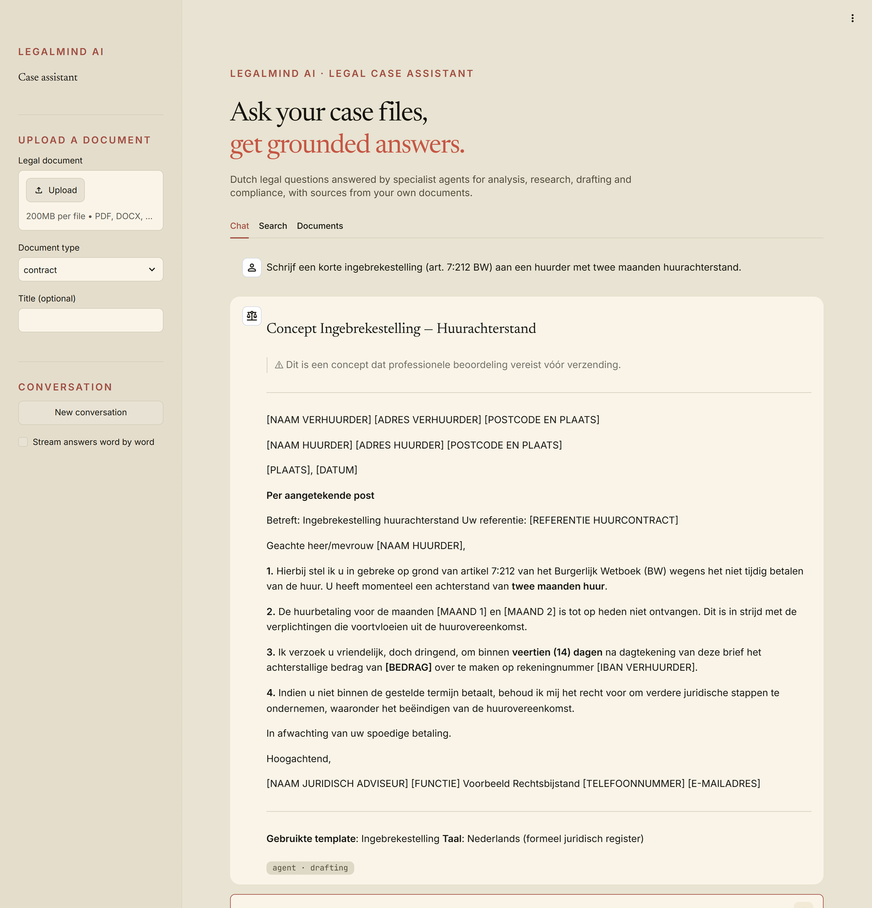
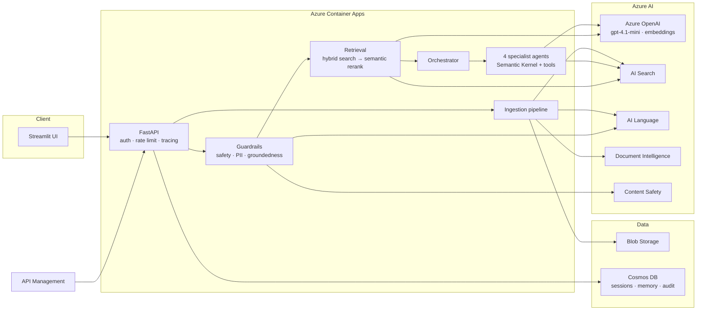
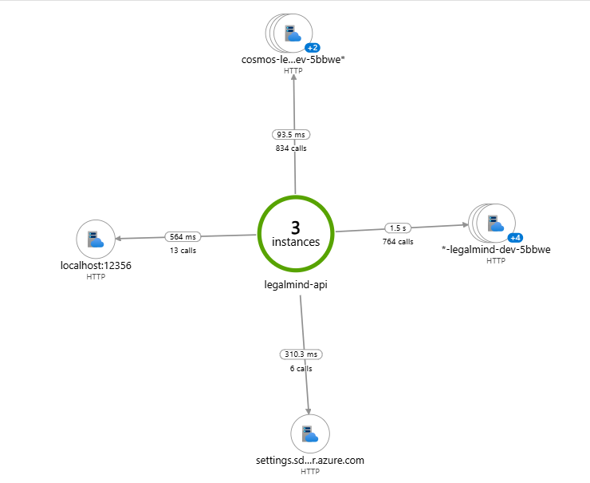

# LegalMind AI

[](https://github.com/munyaradzi-zhou/LegalMind-AI/actions/workflows/ci.yml)


[](LICENSE)

**A multi-agent legal case assistant for Dutch legal services, built on Azure AI.**
It ingests contracts, letters and case files, retrieves the relevant passages with hybrid search, routes each question to a specialist agent, and checks every answer with responsible-AI guardrails before it reaches the user.



---

## What it does

| | |
|---|---|
| **Multi-agent orchestration** | An orchestrator classifies intent and routes to four Semantic Kernel agents — document analysis, legal research, drafting and compliance — each with its own tools, prompts and few-shot examples. Cross-domain questions are handed off between agents (max depth 3). |
| **Retrieval-augmented generation** | Azure AI Search hybrid retrieval: `text-embedding-3-large` vectors + BM25 fused with Reciprocal Rank Fusion, then semantic re-ranking. Every chunk carries a one-line header identifying its document (contextual retrieval). Answers cite their sources `[1]`, `[2]`, … LLM query rewriting is available but off by default — it added 1.3 s without improving retrieval. |
| **Document ingestion** | Upload to Blob Storage → layout analysis (Document Intelligence or Content Understanding) → semantic or parent-child chunking → a contextual header per chunk → enrichment with entities and key phrases (AI Language) → batched embeddings → indexing. Re-ingesting a document replaces its earlier version. |
| **Responsible AI** | Content Safety on every input and output, PII detection (Azure AI Language + Dutch BSN/IBAN/postcode patterns), an LLM groundedness check of each answer against the retrieved context that fails closed, and an audit trail in Cosmos DB. Every answer carries a `grounding` label (`documents`, `not_grounded`, `unverified`, `no_documents`) that the UI shows, and lists only the sources it actually used. |
| **Production plumbing** | FastAPI with SSE streaming, Entra ID JWT auth, rate limiting, structured logs and OpenTelemetry → Application Insights, conversation memory in Cosmos DB. |
| **MCP server** | The knowledge base as Model Context Protocol tools for other agents (Claude, Copilot, Foundry). |

The retriever also includes query decomposition and HyDE, and there is a self-reflection module for answer critique; both are ready to use but not yet in the default chat path.

## Architecture



All service-to-service calls use Microsoft Entra ID through one user-assigned managed identity — there are no API keys or connection strings in the code or the infrastructure.

| Azure service | Used for | Tier (dev) |
|---|---|---|
| Azure OpenAI | Chat (`gpt-4.1-mini`), embeddings (`text-embedding-3-large`, 3072 dims) | Global Standard · Standard |
| Azure AI Search | Hybrid vector + keyword index, semantic ranker | Basic, free semantic plan |
| Azure AI Language | Entities, key phrases, PII | S0 |
| Document Intelligence · Content Understanding | Layout and field extraction from PDF, DOCX and images | S0 |
| Azure AI Content Safety | Harm classification of inputs and outputs | S0 |
| Cosmos DB | Sessions, long-term memory, audit log | Serverless |
| Blob Storage | Original documents | Standard LRS |
| Container Apps + Container Registry | API and UI hosting, scale to zero | Consumption · Basic |
| API Management | Gateway and rate limiting | Consumption |
| Key Vault · Log Analytics · Application Insights | Secrets, logs, traces | Standard · PAYG |

## Running on Azure

Deployed end to end on an Azure subscription and measured with the evaluation suites and Application Insights:



| Measured on the live deployment | |
|---|---|
| Routing to the right specialist agent | 100 % (24 labelled questions) |
| Right passage ranked first — hybrid + semantic ranker vs keyword only | 80 % vs 49 % (35 questions) |
| Expected facts in answers · right source cited | 97 % · 100 % (27 questions, LLM judge) |
| Unanswerable questions declined, incl. near-misses whose answer belongs to another document | 8 / 8 |
| `/api/chat` latency p50 / p95, after removing query rewriting | 7.3 s / 15.7 s (was 14.8 s / 39.5 s) |
| Code-only release (CI green → new revision live) | ~4 minutes |

Along the way the dashboards caught a groundedness check that failed open on malformed JSON, and the evaluations caught answers that ignored retrieved context and facts borrowed from the wrong document — each fixed and re-measured (the last one by giving every chunk a header that names its document).

## Run it locally

Requirements: Python 3.11+, and either an OpenAI API key or deployed Azure resources.

```bash
python -m venv .venv && source .venv/bin/activate   # Windows: .venv\Scripts\activate
pip install -e ".[dev,frontend]"
cp .env.example .env                                 # then set OPENAI_API_KEY, or the Azure endpoints

make run            # API on http://localhost:8000 (Swagger UI at /docs)
make run-frontend   # UI  on http://localhost:8501
```

With only `OPENAI_API_KEY` set, the agents answer with `gpt-4o-mini` from the OpenAI API, conversations are kept in memory, and search and Content Safety are skipped; document upload needs Azure. Point `.env` at Azure endpoints to enable everything. `make up` runs the same two services in Docker.

## Deploy to Azure

```bash
az login
export APIM_PUBLISHER_EMAIL=you@example.com
./scripts/deploy.sh --environment dev --seed
```

[`scripts/deploy.sh`](scripts/deploy.sh) deploys the Bicep templates in [`infra/`](infra), builds and pushes both images to the registry, rolls the Container Apps onto them, uploads the sample documents and runs smoke tests. The search index is created by the API on start-up.

**Continuous delivery.** After CI passes on `main`, [`cd.yml`](.github/workflows/cd.yml) deploys the tested commit to dev, then staging, then prod (behind an approval on the `production` environment), using OIDC — no stored Azure credentials. It activates once the repository variables `AZURE_CLIENT_ID`, `AZURE_TENANT_ID`, `AZURE_SUBSCRIPTION_ID` and `APIM_PUBLISHER_EMAIL` are set.

## API

```bash
# Ask a question (set "stream": true for Server-Sent Events)
curl -X POST localhost:8000/api/chat -H "Content-Type: application/json" \
  -d '{"message": "Wat zijn de opzegvoorwaarden in dit contract?", "stream": false}'

# Ingest a document
curl -X POST localhost:8000/api/ingest -F "file=@contract.pdf" -F "document_type=contract" -F "language=nl"

# Search the knowledge base
curl -X POST localhost:8000/api/search -H "Content-Type: application/json" \
  -d '{"query": "aansprakelijkheid bij arbeidsongeval", "top": 5}'
```

Also: `GET /api/agents`, `GET /health`, `GET /health/ready`. Full schemas at `/docs`.

## Use it from other agents (MCP)

LegalMind is also a [Model Context Protocol](https://modelcontextprotocol.io) server, so any MCP-capable agent — Claude Code or Claude Desktop, GitHub Copilot in VS Code, Azure AI Foundry agents — can use the knowledge base as a tool. It is a thin client of the API, so the same guardrails and audit log apply.

| Tool | Does |
|---|---|
| `ask_legal_question` | Grounded answer with citations; pass `session_id` back for follow-up questions |
| `search_legal_documents` | Hybrid search for passages, optionally by document type |
| `ingest_document` | Add a local PDF, DOCX, TXT or image to the knowledge base |
| `list_agents` | The specialist agents and their tools |

```bash
# Claude Code
claude mcp add legalmind --env LEGALMIND_API_URL=https://<your-api> -- legalmind-mcp

# Any client over HTTP instead of stdio: serves http://127.0.0.1:8001/mcp
LEGALMIND_API_URL=https://<your-api> legalmind-mcp --transport streamable-http
```

## Quality

Every push runs the same gates CI enforces — `make check` locally:

- **Ruff** lint and formatting, **mypy `--strict`** over the whole package
- **125 unit tests** (chunking, contextual headers, guardrails and grounding, PII, confidence scoring, context building, prompts, query rewriting, reflection, token budgets, index schema, orchestrator, MCP tools)
- **Bandit** and **pip-audit** security scans
- **Bicep** compilation of every environment, **Docker** builds of both images, **shellcheck**

Integration tests (`tests/integration`) and retrieval, generation and routing evaluations with golden datasets (`tests/evaluation`) run against a deployed environment: `make test-integration`, `make eval`.

## Project layout

```
src/legalmind/
  agents/       orchestrator, four specialist agents, prompts, Semantic Kernel tools
  retrieval/    hybrid search, query rewriting, context building, index schema
  ingestion/    analysis, chunking, enrichment, embedding, indexing pipeline
  context/      guardrails, sessions, conversation memory, token budgets
  services/     thin async clients for each Azure service
  api/          FastAPI routes, request/response models, middleware
src/frontend/   Streamlit UI
infra/          Bicep: main.bicep, modules/, parameters per environment
scripts/        deploy, seed and smoke-test scripts
tests/          unit, integration and evaluation suites
notebooks/      walkthroughs of document analysis, embeddings, retrieval tuning, prompts and agents
```

## About this project

I built LegalMind AI while preparing for an Azure AI Engineer role in Dutch legal services, to show an end-to-end, production-minded RAG and agent system on Azure. It is not affiliated with any company: the insurer in the prompts and sample documents, *Voorbeeld Rechtsbijstand*, is fictional.

LegalMind AI is a demonstration, not legal advice. Its answers can be wrong and must be checked by a qualified professional.

## License

[MIT](LICENSE) © Munyaradzi Zhou
